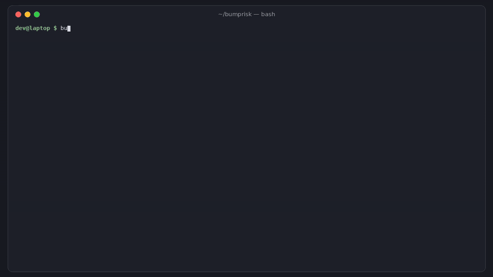

# bumprisk

[](https://github.com/hamarshehmhmd/bumprisk/actions/workflows/ci.yml)
[](LICENSE)


**What does this lockfile change actually pull in?** `bumprisk` reads the lockfile diff in a pull request
(npm, yarn, pnpm, pip requirements, Poetry, uv, PDM, Pipfile) and checks every added or bumped package against
the npm registry, PyPI and OSV.dev: removed or malicious versions, releases that are only hours old, new install
scripts, lost provenance, a different publisher, and vulnerabilities the bump adds or fixes.



```sh
curl -fsSL https://raw.githubusercontent.com/hamarshehmhmd/bumprisk/main/install.sh | sh
```

## The problem

Dependency bots and `npm update` produce lockfile diffs nobody reads. A 3,000-line `package-lock.json` change gets
an "LGTM" because the human-visible part (`"axios": "^1.14.0"`) did not change. That is exactly where recent
supply-chain attacks landed:

- **axios, Mar 31 2026**: a hijacked maintainer account published `axios@1.14.1`, which quietly added a brand-new
  dependency, `plain-crypto-js`, with a malicious install script. The version was pulled within hours, so anyone
  whose bot bumped in that window merged it.
- **chalk / debug / 16 other packages, Sep 8 2025**: phished maintainer, malicious patch releases (`chalk@5.6.1`,
  `debug@4.4.2`, ...) that were live for about two hours.
- **ultralytics 8.3.41 (Dec 2024)** and **num2words 0.5.15 (Jul 2025)** on PyPI: releases built or uploaded by
  attackers, later removed.

Existing tools each cover part of this: Dependabot/Renovate can *delay* bumps (cooldown) but don't explain them;
GitHub's dependency-review-action checks known CVEs and licenses only; Socket.dev covers much more but is a hosted
commercial service. `bumprisk` is a small, local, dependency-free CLI that answers "anything weird in this diff?"
in a few seconds, with links you can act on.

## Install

```sh
curl -fsSL https://raw.githubusercontent.com/hamarshehmhmd/bumprisk/main/install.sh | sh   # private venv in ~/.local/share/bumprisk
# or
pipx install git+https://github.com/hamarshehmhmd/bumprisk
# or
pip install git+https://github.com/hamarshehmhmd/bumprisk
```

Python 3.9+, no runtime dependencies (`tomli` on 3.9/3.10 only).

## Usage

```sh
bumprisk diff                       # lockfiles changed vs origin/$GITHUB_BASE_REF (in CI) or HEAD (locally)
bumprisk diff --base main           # this branch vs main
bumprisk diff --base v1.2 --head v1.3 package-lock.json
bumprisk compare old/package-lock.json new/package-lock.json
bumprisk compare a.txt b.txt --as requirements.txt     # tell it the lockfile type
```

Options: `--cooldown DAYS` (default 7), `--fail-on critical|high|medium|low|never` (default `high`),
`--format text|markdown|json`, `-o FILE`, `-v` (show info-level notes), `--no-osv`.

Exit codes: `0` nothing at or above `--fail-on`, `1` findings at or above it, `2` usage or lockfile error.

Real output for the axios / chalk incidents (the example lockfiles are in [`examples/`](examples)):

```text
$ bumprisk compare examples/npm/old/package-lock.json examples/npm/new/package-lock.json
✖ CRITICAL axios 1.14.0 -> 1.14.1  [npm]
    ✖ OSV lists this version as malicious: MAL-2026-2307
    ✖ axios@1.14.1 was published 2026-03-31 and later removed from the registry; npm pulls compromised releases this way, and installs from this lockfile will fail
✖ CRITICAL chalk 5.3.0 -> 5.6.1  [npm]
    ✖ OSV lists this version as malicious: MAL-2025-46969
    ...
✖ CRITICAL plain-crypto-js 4.2.1 (new)  [npm]
    ✖ npm replaced plain-crypto-js with a security placeholder (0.0.1-security.0): it was removed as malware
    ✖ OSV lists this version as malicious: MAL-2026-2306
✔ 1 look fine: vite 8.3.4 -> 8.3.5

5 changed packages: 4 critical, 1 ok
```

And a routine weekly bump (no incident, just things worth a look):

```text
$ bumprisk diff --base main
▲ MEDIUM   axios 0.34.0 -> 0.35.0  [npm]
    ▲ 0.35.0 was published 4 h ago (cooldown is 7 days); most hijacked releases are caught and pulled within days
    review: npm diff --diff=axios@0.34.0 --diff=axios@0.35.0
▲ MEDIUM   esbuild 0.28.2 (new)  [npm]
    ▲ runs an install script: postinstall: node install.js
▲ MEDIUM   nx 24.0.2 -> 24.0.3  [npm]
    ▲ 24.0.3 was published 3 days ago (cooldown is 7 days); most hijacked releases are caught and pulled within days
• LOW      typescript 5.9.3 -> 6.0.3  [npm]

4 changed packages: 3 medium, 1 low        (exit 0: nothing at --fail-on high)
```

### In GitHub Actions

```yaml
on: pull_request
jobs:
  bumprisk:
    runs-on: ubuntu-latest
    steps:
      - uses: actions/checkout@v4
        with: { fetch-depth: 0 }
      - uses: hamarshehmhmd/bumprisk@v0.1.0
        with:
          fail-on: high      # default
          cooldown: "7"
```

The report is also written to the job summary (`$GITHUB_STEP_SUMMARY`) as a markdown table.

## What it checks

| Severity | npm | PyPI |
|---|---|---|
| critical | version gone and package replaced by a security placeholder; OSV `MAL-` advisory | project quarantined; OSV `MAL-` advisory |
| high | version unpublished; **install script added on an update**; provenance/attestations dropped; new known vulns | version yanked; project/version removed; provenance dropped; new known vulns |
| medium | published within the cooldown; install script in a newly added package; publisher changed; deprecated | published within the cooldown; sdist-only (code runs at install); archived/deprecated project |
| low | brand-new package (< 30 days); low downloads; major / 0.x minor bumps; downgrades; pre-releases | brand-new project; major bumps; downgrades; pre-releases |
| info | known vulns the bump fixes | known vulns the bump fixes |

Every npm update gets a `npm diff --diff=pkg@old --diff=pkg@new` line so the actual code change is one command away.

## What it isn't

- Not a malware scanner: it does not download or analyse tarballs. It relies on registry metadata and OSV.
  A fresh, still-live malicious release shows up as "published 4 h ago" and "install script added", not as "malware".
- It only looks at what changed in the lockfile, not your whole tree (use `npm audit`, `pip-audit`, osv-scanner for that).
- Lookups go to registry.npmjs.org, pypi.org and api.osv.dev (override with `BUMPRISK_NPM_REGISTRY` / `BUMPRISK_PYPI_URL`).

## Development

```sh
python3 -m venv .venv && .venv/bin/pip install -e . pytest
.venv/bin/pytest -q                       # offline unit tests
BUMPRISK_LIVE=1 .venv/bin/pytest -q tests/test_live.py   # hits the real registries
```

## License

GNU Affero General Public License v3.0 or later (AGPL-3.0-or-later), see [LICENSE](LICENSE).
Commercial licenses without the AGPL obligations are available from the author, Mohammad Hamarsheh
([@hamarshehmhmd](https://github.com/hamarshehmhmd)); open an issue or get in touch via GitHub.
